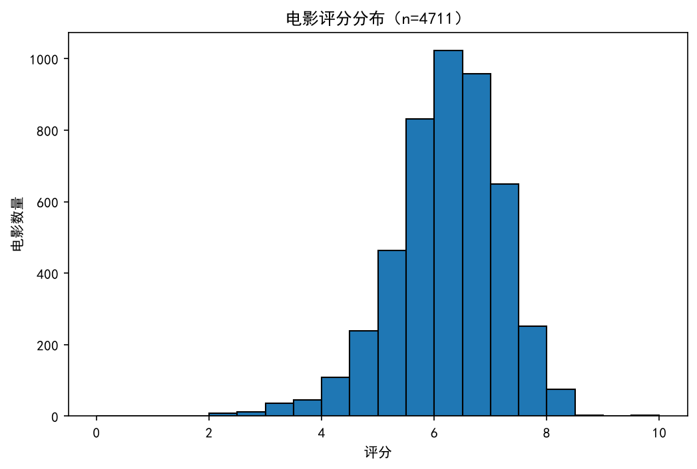
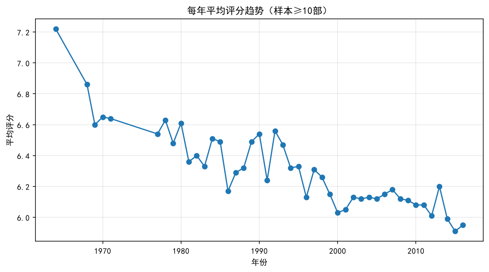
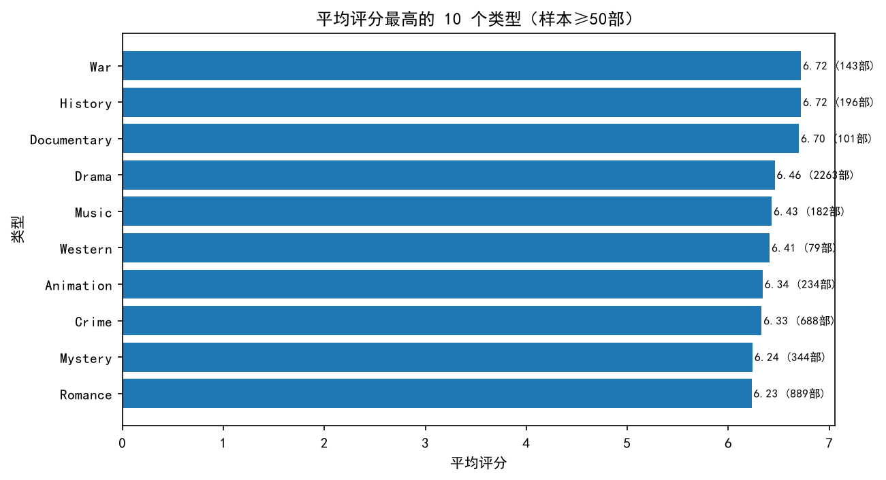

# 电影数据分析报告（TMDB 5000）

用 `pandas` + `matplotlib` 对 TMDB 5000 电影数据做完整分析：读取 → 清洗 → 分组统计 → 可视化。

## 数据来源

- 数据集：TMDB 5000 Movies Dataset（Kaggle）
- 文件：`data/movies_sample.csv`，原始 **4803 行 × 20 列**，上映年份 1916–2017
- 主要字段：`title`、`release_date`、`vote_average`、`vote_count`、`genres`、`production_countries`、`runtime`、`status`

## 环境依赖

已在 Python 3.14.7 上验证：

| 依赖 | 版本 |
|---|---|
| pandas | 3.0.6 |
| numpy | 2.5.3 |
| matplotlib | 3.11.2 |

安装：

```bash
pip install -r requirements.txt
```

## 运行方式

```bash
python run_analysis.py
```

脚本会依次执行：

1. `load_data()` —— 读取 CSV
2. `clean_data()` —— 去重、处理缺失值、类型转换、筛除异常值（**4803 → 4711 行**）
3. `analyze()` —— 按年份 / 类型 / 国家分组统计
4. `visualize()` —— 生成 3 张图并保存到 `images/`

## 结论

1. **评分整体集中在 6 分档**：清洗后 4711 部影片平均 **6.18 分**，直方图峰值落在 6–7 分区间，8 分以上占比很低。
2. **产量在 2009 年达到峰值，但评分在缓慢下行**：2009 年上映 **244 部**为全样本最高；1990–1999 年平均 **6.33 分**，2010–2017 年降至 **6.20 分**，下降 **0.13 分**。注意各年样本量差异较大（2009 年 244 部，早期年份仅几十部），该趋势反映的是当年进入样本的影片整体，不代表单部影片质量下降。
3. **产量最大的类型不等于评分最高**：`Drama` 数量最多（**2263 部**，占样本近一半），平均 **6.46 分**；而 `War` / `History` 平均 **6.72 分**最高（143 / 196 部），比 Drama 高 **0.26 分**。

## 图表

**评分分布**



**每年平均评分趋势**（仅保留样本 ≥ 10 部的年份）



**平均评分 Top10 类型**（仅保留样本 ≥ 50 部的类型）



## 统计明细

类型平均评分 Top10：

| 类型 | 数量 | 平均评分 |
|---|---|---|
| War | 143 | 6.72 |
| History | 196 | 6.72 |
| Documentary | 101 | 6.70 |
| Drama | 2263 | 6.46 |
| Music | 182 | 6.43 |
| Western | 79 | 6.41 |
| Animation | 234 | 6.34 |
| Crime | 688 | 6.33 |
| Mystery | 344 | 6.24 |
| Romance | 889 | 6.23 |

国家产量 Top5（一部影片可能有多个出品国，故合计大于 4711）：

| 国家 | 数量 | 占样本比例 |
|---|---|---|
| United States of America | 3921 | 83.2% |
| United Kingdom | 634 | 13.5% |
| Germany | 324 | 6.9% |
| France | 305 | 6.5% |
| Canada | 260 | 5.5% |

## 数据处理说明

清洗阶段做了这些取舍，都是为了避免「0 值假数据」污染统计：

| 处理 | 原因 | 影响行数 |
|---|---|---|
| `drop_duplicates()` | 整行完全重复 | 0（原数据无重复） |
| 删除 `release_date` 缺失 | 无法提取年份，年度趋势无法计算 | 1 |
| 用中位数填充 `vote_average` | 评分缺失较少，删除会丢样本 | 0（清洗后无缺失） |
| 保留 `vote_count > 0` | vote_count=0 的影片评分是假 0 分 | 62 |
| 保留 `runtime` 在 1–600 分钟 | 0 分钟的运行时是脏数据 | 35 |
| 保留 `status == "Released"` | 未上映影片没有公映口碑，不可比 | 8 |
| 评分限定 0–10、年份限定 1900 以后 | 排除录入错误 | 0 |

`genres` 与 `production_countries` 在原始数据中是 JSON 字符串（如 `[{"id":28,"name":"Action"}]`），
统计前需用 `json.loads` 解析出名称列表，再用 `explode` 把一行拆成多行。

## 目录结构

```
movie-data-analysis/
├── data/movies_sample.csv     # 原始数据
├── images/                    # 输出图表
├── run_analysis.py            # 分析脚本
├── requirements.txt           # 依赖版本
└── README.md
```
